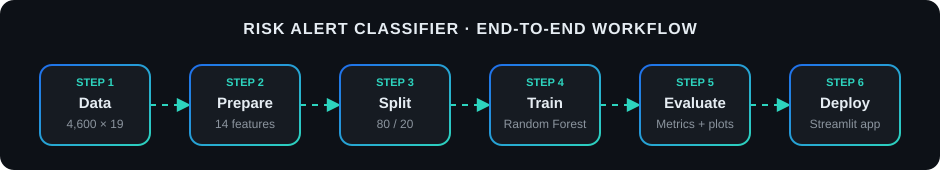

 

  

Live Demo: Open Risk Alert
Classifier
 

> [!IMPORTANT]
> **Educational and analytical prototype.** Predictions are model estimates, **not** financial judgments, and must not be the sole basis for any real credit, lending, collections, or account decision. See [Responsible Use](#-responsible-use-and-ethics).

---

## 📌 At a Glance

| 🗂️ Records | 🧱 Columns | 🎯 Model Features | ✂️ Split | 🌲 Classifier |
|:---:|:---:|:---:|:---:|:---:|
| **4,600** | **19** (18 inputs + target) | **14** | **80 / 20** | **Random Forest** |

---

## 📑 Table of Contents

1. [Overview](#-overview)
2. [Problem Statement](#-problem-statement)
3. [Dataset](#-dataset)
4. [End-to-End Workflow](#-end-to-end-workflow)
5. [Methodology](#-methodology)
6. [Model and Inference](#-model-and-inference)
7. [Evaluation Strategy](#-evaluation-strategy)
8. [Results](#-results)
9. [Streamlit Application](#-streamlit-application)
10. [UX, Interaction and Animation](#-ux-interaction-and-animation)
11. [Visual Outputs](#-visual-outputs)
12. [Repository Structure](#-repository-structure)
13. [Quick Start](#-quick-start)
14. [Reproducibility and Governance](#-reproducibility-and-governance)
15. [Limitations](#-limitations)
16. [Responsible Use and Ethics](#-responsible-use-and-ethics)
17. [Roadmap](#-roadmap)
18. [Tech Stack](#-tech-stack)
19. [Author](#-author)

---

## 🔎 Overview

**Risk Alert Classifier** is a supervised machine-learning project that answers one practical question:

> *Given what we know about a customer's profile, finances, credit behaviour, and account activity, does this record look more like a low-risk or a high-risk case?*

It covers the full path from raw data to a working demo:

| Stage | What it shows |
|---|---|
| 🧹 **Data work** | Inspecting, cleaning, imputing, and scaling customer records |
| 🧠 **Modelling** | Training and evaluating a Random Forest classifier |
| 📊 **Evaluation** | Looking beyond accuracy: precision, recall, F1, ROC-AUC, confusion matrix |
| 🖥️ **Application** | A Streamlit + Plotly dashboard for entering a customer and viewing a prediction |
| 🛡️ **Governance** | Honest limitations, reproducibility rules, and responsible-use guidance |

### ✨ Key Highlights

- **End-to-end workflow**: data inspection → preprocessing → training → evaluation → interactive app.
- **Leakage-aware design**: preprocessing is fitted on training data only, then reused unchanged at inference.
- **Risk-focused evaluation**: explicit attention to *false negatives* (high-risk cases the model misses).
- **Transparent reporting**: no placeholder numbers are presented as results; metrics are filled only from the real test run.
- **Responsible framing**: clear scope, limits, and ethics notes for a model that touches financial topics.

---

## 🎯 Problem Statement

Customer risk is rarely visible in a single number. It tends to show up across several signals at once:

- 💳 **Credit score** and **credit-utilisation ratio**
- ⏱️ **Missed payments** and **average late-payment duration**
- 💰 **Annual income** versus **debt balance**
- 🔄 **Transaction activity** and **cash-advance usage**
- 🕒 **Account tenure** and **recent activity**

Reviewing all of these by hand is slow and inconsistent, especially at scale. This project explores whether a supervised classifier can learn patterns from **labelled 
