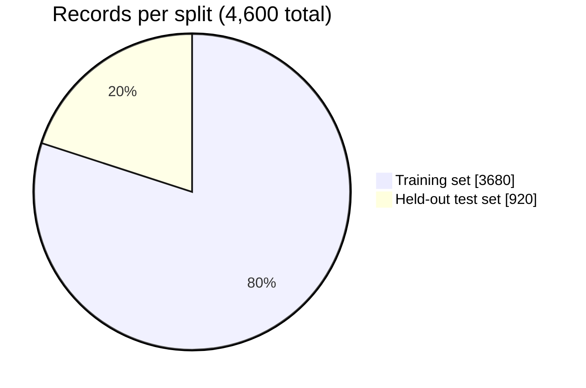
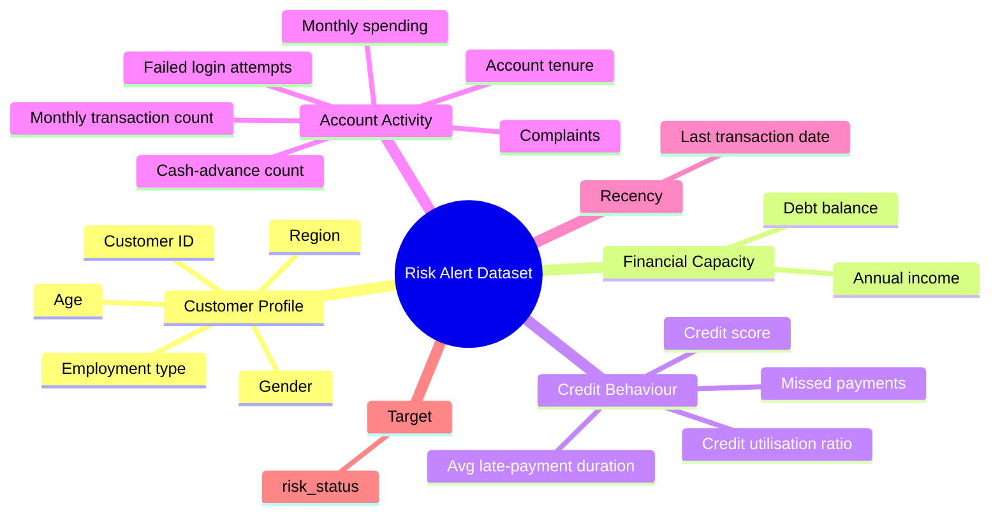
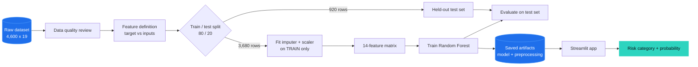
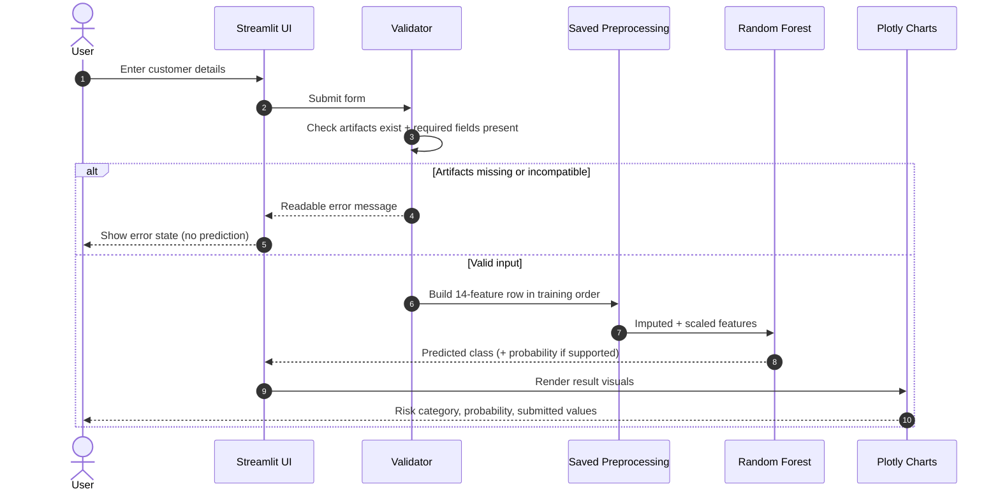
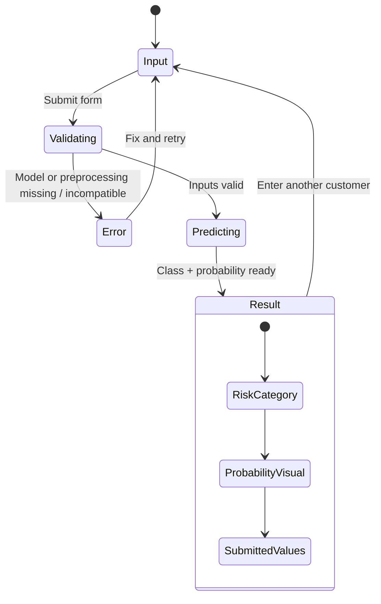

<div align="center">


<a href="https://github.com/your-username/risk-alert-classifier">
  
</a>

<br/>


<br/><br/>


</div>

<br/>

> [!IMPORTANT]
> **Educational and analytical prototype.** Predictions are model estimates, **not** financial judgments, and must not be the sole basis for any real credit, lending, collections, or account decision. See [Responsible Use](#-responsible-use-and-ethics).

---

## 📌 At a Glance

<div align="center">

| 🗂️ Records | 🧱 Columns | 🎯 Model Features | ✂️ Split | 🌲 Classifier |
|:---:|:---:|:---:|:---:|:---:|
| **4,600** | **19** (18 inputs + target) | **14** | **80 / 20** | **Random Forest** |

</div>

---

## 📑 Table of Contents

1. [Overview](#-overview)
2. [Problem Statement](#-problem-statement)
3. [Dataset](#-dataset)
4. [End-to-End Workflow](#-end-to-end-workflow)
5. [Methodology](#-methodology)
6. [Model and Inference](#-model-and-inference)
7. [Evaluation Strategy](#-evaluation-strategy)
8. [Results](#-results)
9. [Streamlit Application](#-streamlit-application)
10. [UX, Interaction and Animation](#-ux-interaction-and-animation)
11. [Visual Outputs](#-visual-outputs)
12. [Repository Structure](#-repository-structure)
13. [Quick Start](#-quick-start)
14. [Reproducibility and Governance](#-reproducibility-and-governance)
15. [Limitations](#-limitations)
16. [Responsible Use and Ethics](#-responsible-use-and-ethics)
17. [Roadmap](#-roadmap)
18. [Tech Stack](#-tech-stack)
19. [Author](#-author)

---

## 🔎 Overview

**Risk Alert Classifier** is a supervised machine-learning project that answers one practical question:

> *Given what we know about a customer's profile, finances, credit behaviour, and account activity, does this record look more like a low-risk or a high-risk case?*

It covers the full path from raw data to a working demo:

| Stage | What it shows |
|---|---|
| 🧹 **Data work** | Inspecting, cleaning, imputing, and scaling customer records |
| 🧠 **Modelling** | Training and evaluating a Random Forest classifier |
| 📊 **Evaluation** | Looking beyond accuracy: precision, recall, F1, ROC-AUC, confusion matrix |
| 🖥️ **Application** | A Streamlit + Plotly dashboard for entering a customer and viewing a prediction |
| 🛡️ **Governance** | Honest limitations, reproducibility rules, and responsible-use guidance |

### ✨ Key Highlights

- **End-to-end workflow**: data inspection → preprocessing → training → evaluation → interactive app.
- **Leakage-aware design**: preprocessing is fitted on training data only, then reused unchanged at inference.
- **Risk-focused evaluation**: explicit attention to *false negatives* (high-risk cases the model misses).
- **Transparent reporting**: no placeholder numbers are presented as results; metrics are filled only from the real test run.
- **Responsible framing**: clear scope, limits, and ethics notes for a model that touches financial topics.

---

## 🎯 Problem Statement

Customer risk is rarely visible in a single number. It tends to show up across several signals at once:

- 💳 **Credit score** and **credit-utilisation ratio**
- ⏱️ **Missed payments** and **average late-payment duration**
- 💰 **Annual income** versus **debt balance**
- 🔄 **Transaction activity** and **cash-advance usage**
- 🕒 **Account tenure** and **recent activity**

Reviewing all of these by hand is slow and inconsistent, especially at scale. This project explores whether a supervised classifier can learn patterns from **labelled historical records** and apply them to a **new record**.

How useful that is depends on four things: **data quality**, **how representative the dataset is**, **correct and consistent preprocessing**, and **rigorous evaluation on data the model never saw during training**.

---

## 🗃️ Dataset

**Name:** Risk Alert Classifier Dataset

| Characteristic | Details |
|---|---|
| Records | 4,600 |
| Total columns | 19 |
| Original input columns | 18 |
| Target column | `risk_status` |
| Training records | 3,680 |
| Test records | 920 |
| Split | 80% training / 20% testing |
| Saved classifier | Random Forest Classifier |
| Model input dimensionality | 14 features |

### Train / Test Split



> [!NOTE]
> The counts match an 80/20 split. Confirm the final notebook's configuration (including any `stratify=` argument and the random seed) before describing the split as *stratified* in a formal report.

### Data Domains



> [!WARNING]
> **18 inputs, 14 model features.** The model does **not** receive all original columns. The exact feature selection, order, and transformations must match the training notebook and the saved preprocessing artifacts.

### 🏷️ Target Variable

The target is **`risk_status`**. Before presenting any prediction as *Low Risk* or *High Risk*, verify the label mapping in **both** the source data and the saved model. In particular, confirm whether `0 = Low Risk` and `1 = High Risk`.

---

## 🔄 End-to-End Workflow



| # | Stage | What happens | Output |
|:-:|---|---|---|
| 1 | **Data ingestion** | Load the dataset; confirm shape, column names, dtypes, and target label | Verified dataframe |
| 2 | **Data quality review** | Check missing values, invalid entries, odd ranges, duplicates, class balance | Issues list |
| 3 | **Feature definition** | Separate target from inputs; document what is kept, transformed, or dropped | Feature specification |
| 4 | **Train/test separation** | Split *before* fitting any transformation | 3,680 / 920 records |
| 5 | **Preprocessing** | Impute missing values and scale, using training data only | 14-feature matrices |
| 6 | **Model training** | Fit the Random Forest on the training set | Trained classifier |
| 7 | **Evaluation** | Score on the held-out test set | Metrics and plots |
| 8 | **Artifact saving** | Persist the classifier **and** all fitted preprocessing objects | Versioned artifacts |
| 9 | **Application inference** | Validate input → transform → predict | Class + probability |
| 10 | **Result presentation** | Show category, probability visual, and submitted values | Dashboard view |
| 11 | **Review and improvement** | Investigate errors; retrain only through a documented process | New model version |

---

## 🧪 Methodology

### 1️⃣ Data Understanding
Check dimensions, data types, missing values, target distribution, and feature meaning. Data-quality concerns are caught *before* training, not after.

### 2️⃣ Feature Preparation
The original matrix has **18** input columns; preparation produces a **14-feature** matrix. Categorical variables and dates need deliberate handling, because a model trained on transformed numeric data cannot safely accept arbitrary raw inputs.

### 3️⃣ Train/Test Split
The training portion fits model parameters **and** preprocessing transformations. The test portion stays untouched until final evaluation, which gives a less biased estimate of performance on unseen records.

### 4️⃣ Missing-Value Handling and Scaling

The notebook produces imputed and scaled matrices with 14 features each. The rule that matters most:

> **Fit on training data only. Save. Reuse unchanged at inference.**

<details>
<summary><b>🔍 Why this rule matters (click to expand)</b></summary>

<br/>

If an imputer or scaler is fitted on the full dataset, information from the test set leaks into training. Evaluation then looks better than reality. If a new scaler is fitted on a *single* customer's input at prediction time, the transformation is meaningless, because one row has no spread to scale against.

Correct pattern (illustrative, adapt to the notebook's actual strategy):

```python
from sklearn.model_selection import train_test_split

X_train, X_test, y_train, y_test = train_test_split(
    X, y, test_size=0.20, random_state=SEED  # add stratify=y if the notebook uses it
)

imputer = ...  # fit on X_train ONLY
scaler  = ...  # fit on the imputed X_train ONLY

X_train_prepared = scaler.transform(imputer.transform(X_train))
X_test_prepared  = scaler.transform(imputer.transform(X_test))  # transform only, never fit
```

</details>

### 5️⃣ Model Development

The saved model is a **Random Forest Classifier**: many decision trees, each trained on a different sample of the data, voting together on the final class. This makes it good at capturing **nonlinear relationships** and **feature interactions** (for example, high utilisation *combined with* missed payments).

Other classifiers may be compared during experimentation. Any comparison should use the **same splits and evaluation procedure**, and report the metrics actually observed rather than assuming one model is better.

### 6️⃣ Evaluation
See [Evaluation Strategy](#-evaluation-strategy).

---

## 🧠 Model and Inference

| Item | Detail |
|---|---|
| Classifier | `RandomForestClassifier` |
| Expected input | **14 features** |
| Feature names stored in model? | **No.** `feature_names_in_` is not exposed |
| Consequence | Feature **names and order** cannot be recovered from the model object alone |

Because the model cannot describe its own inputs, reliable predictions depend on the application using **the exact feature sequence and the same fitted preprocessing objects** as training. The classifier, imputer, scaler, and feature-selection logic should be **versioned together**.

### Inference Sequence



<details>
<summary><b>🧩 Reference inference pattern (click to expand)</b></summary>

<br/>

An illustrative guard-rail pattern. Replace the placeholders with the real artifact names, the **exact 14 feature names in training order**, and the same preprocessing order used in the notebook.

```python
import joblib
import pandas as pd

MODEL_PATH = "models/risk_classifier.joblib"   # adjust to your layout
FEATURE_COLUMNS = [
    # TODO: list the exact 14 feature names, in training order
]

model = joblib.load(MODEL_PATH)
# imputer = joblib.load("models/imputer.joblib")   # if used in training
# scaler  = joblib.load("models/scaler.joblib")    # if used in training


def predict(raw: pd.DataFrame):
    missing = [c for c in FEATURE_COLUMNS if c not in raw.columns]
    if missing:
        raise ValueError(f"Missing required inputs: {missing}")

    X = raw[FEATURE_COLUMNS]                 # enforce names and order
    # X = scaler.transform(imputer.transform(X))   # mirror the notebook exactly

    if X.shape[1] != model.n_features_in_:
        raise ValueError(
            f"Expected {model.n_features_in_} features, got {X.shape[1]}."
        )

    label = model.predict(X)[0]
    proba = model.predict_proba(X)[0] if hasattr(model, "predict_proba") else None
    return label, proba
```

</details>

---

## 📏 Evaluation Strategy

**Accuracy alone is not enough**, especially when classes are imbalanced. A model that always predicts "low risk" can look accurate while missing every high-risk customer.

### Metrics Used

| Metric | Plain-language meaning | Why it matters here |
|---|---|---|
| **Precision** | Of the records flagged high risk, how many truly were? | Controls false alarms |
| **Recall / Sensitivity** | Of all truly high-risk records, how many did we catch? | Controls **missed risks** |
| **F1-score** | Balance between precision and recall | One-number summary of the trade-off |
| **ROC-AUC** | How well the model ranks high-risk above low-risk across thresholds | Threshold-independent quality |
| **Precision-Recall curve** | Precision vs recall as the threshold moves | Useful under class imbalance |
| **Confusion matrix** | Exact counts of right and wrong calls per class | Shows *which* mistakes are made |

### Reading the Confusion Matrix

|  | **Predicted Low Risk** | **Predicted High Risk** |
|---|:---:|:---:|
| **Actually Low Risk** | ✅ True Negative | ⚠️ False Positive (false alarm) |
| **Actually High Risk** | 🚨 **False Negative** (missed risk) | ✅ True Positive |

> [!TIP]
> For a risk-alert use case, **false negatives deserve explicit attention**: high-risk records incorrectly predicted as low risk. The acceptable balance between false negatives and false positives must be **defined for the intended use case**, and any threshold tuning should be done on **validation data, not the final test set**.

### Recommended Evaluation Outputs

- [ ] Confusion matrix
- [ ] Precision, recall, F1-score
- [ ] ROC curve and ROC-AUC
- [ ] Precision-Recall curve
- [ ] Class distribution before and after any resampling
- [ ] Model comparison chart
- [ ] Random Forest feature importance (interpreted cautiously, it is **not** a causal explanation)

---

## 🏆 Results

> [!CAUTION]
> **Final test-set metrics have not been added yet.** Populate this table **only** from the final evaluation output. Do not publish estimated or illustrative numbers as results.

| Evaluation item | Final result |
|---|---|
| Accuracy | _To be filled from final test evaluation_ |
| Precision | _To be filled from final test evaluation_ |
| Recall | _To be filled from final test evaluation_ |
| F1-score | _To be filled from final test evaluation_ |
| ROC-AUC | _To be filled from final test evaluation_ |
| False negatives | _To be filled from final confusion matrix_ |
| False positives | _To be filled from final confusion matrix_ |
| **Selected model** | **Random Forest Classifier** |
| **Test-set size** | **920 records** |

When the numbers are added, also update the **Final Metrics** badge at the top of this file.

---

## 🖥️ Streamlit Application

An interactive interface that turns the trained model into something you can actually try.

### Capabilities

| Capability | Status |
|---|---|
| Customer financial and account-activity input form | ✅ Included |
| Model-generated risk-category prediction | ✅ Included |
| Risk probability display (when the classifier supports it) | ✅ Included |
| Plotly-based visual presentation | ✅ Included |
| Model status and error feedback | ✅ Included |
| Feature and model information section | ✅ Included |

> [!NOTE]
> A classifier's probability output is **not automatically a calibrated estimate** of real-world risk. Calibration and external validation are required before operational interpretation.

### Application State Flow



| Stage | What the user sees |
|---|---|
| **Input** | Grouped fields for customer financial and account-activity data |
| **Validation** | Checks that the model exists and the input fits the expected feature format |
| **Prediction** | Saved classifier produces a class and, when available, a probability |
| **Result** | Risk category, probability visual, and the submitted feature values |
| **Error** | A readable message instead of an unverified result |

---

## 🎨 UX, Interaction and Animation

The interface uses a **dark dashboard layout**, **grouped input fields**, **clear result states**, and **interactive Plotly charts**.

### What Is Implemented vs. Planned

| Visual feature | Status |
|---|---|
| Dark dashboard layout with grouped inputs | ✅ Implemented |
| Interactive Plotly visualisation | ✅ Implemented |
| Distinct result and error states | ✅ Implemented |
| Loading indicator during prediction | 🛠️ Opportunity |
| Smooth reveal of the result panel | 🛠️ Opportunity |
| Animated Plotly gauge for high-risk probability | 🛠️ Opportunity |
| Lightweight transitions between input and result | 🛠️ Opportunity |

> Items marked **Opportunity** should be described as *implemented* only after they have been added and tested in `app.py`.

### Design Principles

- **Short and restrained**: motion supports the prediction flow, it never decorates it.
- **Text first**: risk category and probability stay readable without animation.
- **Never colour alone**: results use labels and icons as well as colour.
- **Honest signalling**: motion must not imply more certainty than the model has. A probability is an *estimate* and may not be calibrated.
- **Fast**: no effect should slow inference or hurt responsiveness.

---

## 📈 Visual Outputs

Generate these from the **actual evaluation run** and keep them in sync with the dataset and model version. Illustrative charts must never be presented as measured results.

| Output | Purpose | Suggested file |
|---|---|---|
| Target-class distribution | Reveal class imbalance | `assets/class_distribution.png` |
| Confusion matrix | Show exact error types | `assets/confusion_matrix.png` |
| ROC curve | Ranking quality across thresholds | `assets/roc_curve.png` |
| Precision-Recall curve | Performance under imbalance | `assets/pr_curve.png` |
| Model comparison chart | Compare candidate models fairly | `assets/model_comparison.png` |
| Feature-importance chart | Which inputs the forest relied on | `assets/feature_importance.png` |
| App screenshots / GIF | Show the dashboard in action | `assets/app_demo.gif` |

<!--
Once the images exist, embed them like this:

<p align="center">
  
  
</p>

<p align="center">
  
</p>
-->

---

## 📂 Repository Structure

> Directory names may differ in your local project. Adjust this tree to match it.

```text
risk-alert-classifier/
├── assets/                 # Evaluation plots, screenshots, README visuals
│   └── pipeline-flow.svg
├── data/                   # Source dataset (omit if it contains sensitive records)
├── models/                 # Saved classifier + fitted preprocessing artifacts
├── notebooks/              # Training notebook: inspection, preparation, training, evaluation
├── app.py                  # Streamlit application
├── requirements.txt        # Pinned dependencies
└── README.md
```

> [!WARNING]
> Do not commit sensitive customer records, credentials, or large artifacts unless permissions and repository access controls explicitly allow it.

---

## 🚀 Quick Start

```bash
# 1. Clone
git clone https://github.com/your-username/risk-alert-classifier.git
cd risk-alert-classifier

# 2. Create an isolated environment
python -m venv .venv
source .venv/bin/activate        # Windows: .venv\Scripts\activate

# 3. Install dependencies
pip install -r requirements.txt

# 4. Launch the app
streamlit run app.py
```

### ✅ Pre-Flight Checklist

Verify these **before** launching:

- [ ] Required packages are installed in the **same environment** used to run Streamlit
- [ ] The classifier exists at the path the application expects
- [ ] The saved imputer and scaler are present (if used in training)
- [ ] Feature **names, order, and preprocessing** match the training notebook
- [ ] Model and preprocessing artifacts were created with **compatible library versions**

---

## 🔁 Reproducibility and Governance

To make results repeatable by someone else, retain:

| Item | Why |
|---|---|
| Dataset version and provenance | Know exactly what was learned from |
| Split procedure and random seed | Recreate the same train/test sets |
| Final feature list **and order** | Prevent silent input mismatches |
| Fitted preprocessing artifacts | Reproduce training-time transformations |
| Model hyperparameters | Rebuild the same model |
| Selection criteria | Explain *why* this model was chosen |
| Metrics and confusion matrix | Evidence for every claim |
| Python and library versions | Avoid artifact incompatibility |
| Artifact version | Tie model, scaler, and imputer together |

Keep **training, validation, and held-out test data separate**. If the dataset changes, **repeat the evaluation** rather than assuming earlier performance still applies.

---

## ⚠️ Limitations

- Dataset representativeness and label quality have **not** been independently verified.
- Final accuracy, recall, F1-score, and ROC-AUC values have **not** been supplied yet.
- The model does not expose feature names, so consistency with the training code is essential.
- The 14-feature model may omit information present in the original 18 inputs.
- Customer identifiers are generally not meaningful predictors and can introduce spurious patterns. A model **without** identifier fields should be evaluated.
- Predicted probabilities may be **uncalibrated**.
- A random split may not reflect future deployment conditions or changes over time.
- Performance can differ across customer groups and across time.
- Predictions are **not** causal explanations or definitive financial judgments.

---

## 🛡️ Responsible Use and Ethics

Risk classification can affect people's access to financial products and services. This prototype is for **learning, experimentation, and demonstration**.

**It should not be the sole basis for** real credit, lending, collections, account restrictions, or any other high-impact decision.

Before any operational use, a model like this would need:

| Requirement | Purpose |
|---|---|
| Legal and compliance review | Meet applicable regulation |
| Data-governance controls | Protect customer data |
| Independent validation | Confirm performance claims |
| Probability calibration | Make scores interpretable |
| Bias and subgroup assessment | Detect unequal performance |
| Human oversight | Keep accountable people in the loop |
| Drift monitoring | Catch degradation over time |
| Error-correction process | Fix wrong outcomes for affected people |

Sensitive or protected characteristics should be handled only in accordance with applicable law and a clearly justified purpose.

---

## 🗺️ Roadmap

- [ ] Package preprocessing and classification into **one validated pipeline**
- [ ] Store and version the **exact feature names and order** alongside the model
- [ ] Evaluate a model that **excludes customer identifiers**
- [ ] Add **cross-validation** and systematic hyperparameter tuning
- [ ] Compare **baseline and tree-based models** on consistent validation splits
- [ ] Assess class imbalance and **threshold selection** using validation data
- [ ] **Calibrate** predicted probabilities where appropriate
- [ ] Report **uncertainty and subgroup performance** where the data permits
- [ ] Add **automated schema validation** and prediction tests
- [ ] **Monitor** performance and data drift if deployed beyond a demonstration
- [ ] Add and test UI motion (loading state, result reveal, animated gauge)

### 🎯 Next Milestone

1. Confirm the exact **14-feature training schema**
2. Save and reuse the **fitted preprocessing artifacts**
3. Add **actual test-set metrics and plots** from the final notebook

---

## 🧰 Tech Stack

<div align="center">


</div>

| Tool | Role |
|---|---|
| Python | Machine-learning workflow |
| Pandas, NumPy | Data handling |
| Scikit-learn | Preprocessing, model training, evaluation |
| Joblib | Model artifact persistence |
| Streamlit | Interactive web application |
| Plotly | Interactive charts |
| Jupyter Notebook | Experimentation and analysis |

---

## 👤 Author

**Roshan**, AI/ML Engineer

[](https://github.com/your-username)
[](https://linkedin.com/in/your-profile)

---

<div align="center">

### 📝 Project Summary

| | |
|---|---|
| **Project** | Risk Alert Classifier |
| **Model family** | Random Forest Classifier |
| **Application** | Streamlit |
| **Status** | Prototype for educational and analytical demonstration |

<sub>Built for learning. Evaluated honestly. Documented to be reproduced.</sub>


</div>
